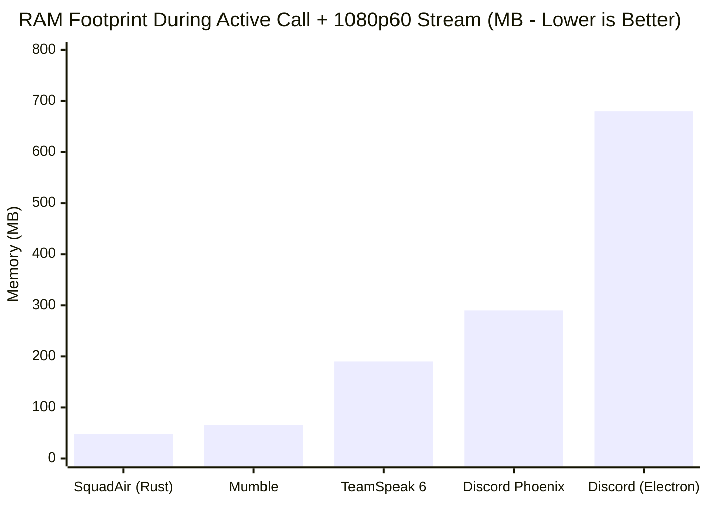
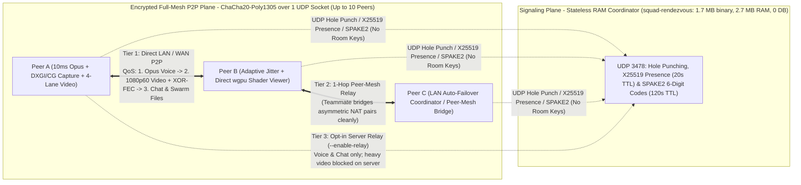

<p align="center">
  
</p>

<h1 align="center">SquadAir</h1>

<p align="center">
  <strong>Ultra-lightweight, zero-knowledge P2P voice &amp; 1080p60 screen sharing built in pure Rust — engineered for competitive gamers who count every FPS.</strong>
</p>

<p align="center">
  <a href="https://squadair.app/"></a>
  <a href="https://apps.microsoft.com/detail/9PH8NXTQMC73"></a>
  <a href="https://snapcraft.io/squad-air"></a>
  <a href="https://github.com/alivergg/homebrew-tap"></a>
  <a href="https://github.com/alivergg/scoop-bucket"></a>
  <a href=".github/workflows/ci.yml"></a>
  <a href=".github/workflows/release.yml"></a>
  <a href="Cargo.toml"></a>
  <a href="#quick-start--self-hosting"></a>
  
  
  
  <a href="LICENSE"></a>
</p>

<p align="center">
  <a href="https://squadair.app/"><strong>Website (squadair.app)</strong></a> •
  <a href="#why-squadair">Why SquadAir?</a> •
  <a href="#benchmarks">Benchmarks</a> •
  <a href="#features">Features</a> •
  <a href="#architecture">Architecture</a> •
  <a href="#quick-start--self-hosting">Quick Start &amp; Self-Hosting</a>
</p>

---

[**SquadAir**](https://squadair.app/) sends voice, 1080p60 screen streams, screenshots, and files **directly peer-to-peer over a single encrypted UDP socket** (`ChaCha20-Poly1305`). No Electron runtime, no central media servers, no accounts, and no background bloat stealing 1% lows during clutch rounds.

---

## Why SquadAir?

1. **Zero FPS Loss in Competitive Shooters:**
   No Chromium, no V8, no background web workers. SquadAir compiles to a native Rust binary (`26 MB` on macOS Apple Silicon, `35 MB` standalone on Windows, `12 MB` macOS `.pkg` installer) with a GPU-accelerated `iced` 0.13 UI, a persistent click-through left-center HUD overlay (`overlay_platform.rs`), and working-set trimming when minimized to the system tray (~`3.5–6 MB` RAM during matches on Windows).
2. **Free 1080p 60fps Screen Sharing (Zero Nitro Paywalls):**
   Share monitors or individual game windows at **720p / 1080p / Native** and **30 / 60 FPS** with **DXGI Desktop Duplication** + `timeBeginPeriod(1)` on Windows and persistent **CoreGraphics** `CGBitmapContext` capture on macOS. A decoupled capture/encode pipeline, 4-lane parallel stripe codec (`IDR_MODE_JPEG_STRIPED`), atomic frame-tile coherency (zero stale checkerboard artifacts in high-motion shooters), interleaved XOR-FEC, and a direct `wgpu::Texture` fragment shader deliver smooth 60 FPS playback with **0% capture/encode load** when nobody is watching.
3. **True Zero-Knowledge Privacy (No Accounts, No Phone Numbers, No Logs):**
   No emails, no tokens, no server databases. Every voice packet, video fragment, chat message, and file chunk is encrypted end-to-end with `ChaCha20-Poly1305` (keys derived via `BLAKE3` from a 256-bit client-side room secret). The `1.7 MB` `squad-rendezvous` coordinator holds only ephemeral peer coordinates, friend presence, and PAKE handshakes in RAM with strict TTL eviction.
4. **2-Second Squad Connect (Without Alt-Tabbing to Messengers):**
   Read a **6-digit voice code** (`482-910`) over CS2/Valorant in-game voice (brute-force hardened via `SPAKE2` + server rate limiting), click a friend in your **`X25519` Friends Sidebar** to ring them in 1 click, invite extra teammates into an active room with **Invite to Party**, click **Join** under **LAN Rooms Nearby** (optionally protected with a LAN `SPAKE2` room password), or paste an encrypted `squad://` deep link.

---

## Benchmarks

> Measured binary sizes come directly from `cargo build --release --locked` on macOS Apple Silicon and Windows `x86_64` (`squad-rendezvous` live runtime measured at `2,768 KB` RSS). Active client RAM/CPU rows reflect typical Windows release profiles (`SetProcessWorkingSetSize` tray trimming) vs Chromium/Electron and VoIP baselines.

### SquadAir Runtime & Footprint Summary (Release Build)

| Operational State | RAM Footprint | CPU Usage | Binary / Media Notes |
| :--- | :---: | :---: | :--- |
| **Minimized to System Tray (Windows In-Game)** | **~3.5 – 6 MB** | **< 0.2%** | Shrinks video/chat buffers & trims OS working set (`SetProcessWorkingSetSize`) |
| **Idle in Lobby (Window Open, Est. Windows)** | **~28 – 38 MB** | **< 0.1%** | Native `iced` 0.13 + GPU surface idle wait |
| **Active Voice Call (10ms Opus + RNNoise + AEC3, Est.)** | **~36 – 46 MB** | **0.4 – 0.9%** | Lock-free `cpal` + `ringbuf` SPSC + real-time DSP thread |
| **Active Call + 1080p 60fps Screen Share (Est.)** | **~48 – 64 MB** | **1.2 – 2.5%** | 4-lane parallel stripe codec + direct `wgpu::Texture` shader |
| **`squad-rendezvous` Server (Measured Live RSS)** | **~2.7 MB (`2,768 KB`)** | **< 0.1%** | **`1.7 MB`** (`1,819,680 B`) native executable, zero database |

### RAM Comparison During Active Call + 1080p60 Stream



### Resource Overhead At a Glance

```text
RAM Usage (Minimized to Tray - In Match):
  SquadAir    [█░░░░░░░░░░░░░░░░░░░]  ~3.5 MB (Working-set trimmed on Windows)

RAM Usage (Active Squad Call + 1080p60 Screen Share):
  SquadAir    [██░░░░░░░░░░░░░░░░░░]  ~48 MB
  TeamSpeak 6 [██████░░░░░░░░░░░░░░] ~190 MB
  Discord     [████████████████████] ~680+ MB

CPU Overhead in CS2 (1080p60 Share + Voice):
  SquadAir    [█░░░░░░░░░░░░░░░░░░░]  < 1.5% (DXGI / VideoToolbox + 4-Lane Codec + wgpu Shader)
  Discord     [███████░░░░░░░░░░░░░]  6-12%  (Chromium + WebRTC + Electron UI)

Voice Frame & Transport Latency:
  SquadAir    [██░░░░░░░░░░░░░░░░░░]  10 ms Opus Frame + Direct P2P UDP
  Cloud VoIP  [████████░░░░░░░░░░░░]  20-60 ms + Centralized Server Hop

Client Binary / Installer Footprint:
  SquadAir    [█░░░░░░░░░░░░░░░░░░░]  12 MB (.pkg) / 26-35 MB (Native Binary)
  Discord     [████████████████████]  ~350+ MB
```

### Feature & Privacy Matrix

| Capability | **SquadAir** | Discord | TeamSpeak 6 | Mumble |
| :--- | :---: | :---: | :---: | :---: |
| End-to-End Encryption (Voice, Chat, Video, Files) | **Yes (`ChaCha20-Poly1305`)** | Partial / Closed | Optional | TLS (Server-terminated) |
| Free 1080p 60fps Screen Sharing | **Yes (Native, No Paywall)** | Paid Nitro Required | Yes | No |
| Zero Central Media Bandwidth / Zero Logs | **Yes (Direct P2P / Peer-Mesh)** | No (Cloud SFU) | No (Server-hosted) | No (Server-hosted) |
| No Account / Email / Phone Required | **Yes** | No | Optional | Yes |
| 6-Digit Voice Code Join (`SPAKE2`) | **Yes** | No | No | No |
| Zero-Config LAN Rooms + Host Failover | **Yes** | No | No | No |
| Click-Through In-Game HUD Overlay | **Yes (Native AppKit / Win32)** | Yes | Via Plugin | Overlay (Legacy hooks) |
| P2P Swarm File & Screenshot Sharing | **Yes (`BLAKE3` verified)** | Server-uploaded | Server-uploaded | No |
| Self-Hostable Coordinator (`1.7 MB` / `2.7 MB` RAM) | **Yes (1 UDP port / Docker)** | No | Heavy proprietary server | `murmurd` |
| Open Source | **Yes (GNU AGPLv3)** | No | No | Yes |

---

## Architecture

SquadAir strictly separates **ephemeral signaling/discovery** from the **end-to-end encrypted P2P media & swarm data plane**.



### 5-Crate Rust Workspace

| Crate | Responsibility |
| :--- | :--- |
| [`crates/squad-proto`](crates/squad-proto) | Binary Big-Endian wire protocol (`MAX_UDP_PAYLOAD = 1200`), `BLAKE3` + `ChaCha20-Poly1305` AEAD, 128-packet `ReplayWindow` + 2048-packet `LargeReplayWindow` (video), `SPAKE2` &amp; LAN discovery datagrams, `squad://` URI codec |
| [`crates/squad-rendezvous`](crates/squad-rendezvous) | Stateless Tokio UDP coordinator (`--bind 0.0.0.0:3478`, opt-in `--enable-relay` for voice/chat only), 6s room TTL, 20s presence TTL, 120s 6-digit code TTL, per-IP rate limiting |
| [`crates/squad-dsp`](crates/squad-dsp) | Lock-free `cpal` + `ringbuf` SPSC audio engine, `rubato` resampling, WebRTC `aec3`, `nnnoiseless` RNNoise + `tract-onnx` DeepFilterNet3, 48 kHz / 10 ms Opus, adaptive jitter buffer + PLC, soft limiter, cue gain scaler |
| [`crates/squad-video`](crates/squad-video) | Persistent macOS CoreGraphics &amp; Windows DXGI Desktop Duplication / GDI capture, 4-lane parallel stripe codec with atomic tile coherence, decoupled 2-thread capture/encode, interleaved XOR-FEC &amp; IDR gating |
| [`crates/squad-client`](crates/squad-client) | `iced` 0.13 Material 3 Dark UI, custom `wgpu` zero-copy video shader, native click-through overlay, global hotkeys (`Mouse3/4/5`), system tray, encrypted swarm chat/transfers, `X25519` friends, and auto-updater |

---

## Features

### Pro-Grade Voice DSP (`squad-dsp`)
- **Strict 10 ms Low-Latency Opus:** 48 kHz mono Opus (`audiopus`) in 480-sample frames with selectable bitrates (**24 / 40 / 64 / 96 kbps**), DTX silence gating, in-band FEC, Packet Loss Concealment (PLC), and selectable jitter profiles (**LAN 10 ms**, **Low 20 ms**, **Balanced 30 ms**, **Wi-Fi 50 ms**).
- **Zero-Glitch Real-Time Pipeline:** `cpal` audio callbacks stay strictly lock-free, allocation-free, and log-free, talking to a dedicated DSP worker over `ringbuf` SPSC ring buffers with `rubato` sample-rate adaptation.
- **Echo & Neural Noise Suppression:** Toggleable **WebRTC AEC3** for speakers, built-in **RNNoise**, or optional **DeepFilterNet3** ONNX inference, plus a **Hear Yourself** mic loopback test and live dB threshold meter.
- **Hotkeys, Hot-Plug & Volume Controls:** Global keybinds for **Push-to-Mute** (`KeyV`), **Push-to-Talk** (`CapsLock`), **Toggle Mute** (`F9`), and **Toggle Deafen** (`F10`) supporting `Mouse3` / `Mouse4` / `Mouse5`; automatic CoreAudio/WASAPI hot-plug & Bluetooth HFP recovery; per-peer volume sliders (`0%–200%`); and a dedicated **System Sounds Volume** slider (`0%–200%`, `Muted` at `0%`, with **Test** button).

### 60 FPS Zero-Square Screen Sharing & GPU Shader Renderer (`squad-video`)
- **Zero Desync Checkerboard Squares:** P-frames update atomically only when `<= 25%` of 64x64 tiles change and 100% of dirty tiles fit within bitrate budget; high-motion scenes automatically emit synchronous full-frame updates across 4 parallel worker lanes (`IDR_MODE_JPEG_STRIPED`).
- **Low-Overhead Native Capture:** **DXGI Desktop Duplication** + `timeBeginPeriod(1)` on Windows (with transparent fallback to persistent GDI DIB capture for windows/UAC) and persistent `CGBitmapContext` with `Copy` blend mode on macOS.
- **Direct `wgpu::Texture` Shader Presentation:** Remote streams and local preview upload frames into a single persistent GPU texture via `queue.write_texture` inside a custom `iced::widget::shader` WGSL pass, avoiding per-frame RGBA texture-atlas thrashing.
- **Resilient Transport & Codec Negotiation:** Dedicated `LargeReplayWindow` (2048 packets), batched UDP reads (up to 32 datagrams/wakeup), paced 16-packet TX bursts, interleaved XOR-FEC across groups, strict IDR keyframe gating, **H.264 / H.265** selection with automatic viewer fallback, and **stream audio sharing** (`0%–200%` viewer slider).

### 2-Second Connect: `X25519` Friends, `SPAKE2` 6-Digit Codes & LAN Mode
- **Decentralized `X25519` Friends:** Share your permanent Friend ID (`sqf_...`), see live online / in-room badges via stateless RAM presence pings, ring friends with a popup **Incoming Call** modal, or pull teammates mid-match via **Invite to Party**.
- **6-Digit Voice Codes (`SPAKE2`):** Generate an ephemeral `482-910` room code backed by server rate limiting and a `SPAKE2` PAKE exchange so even the coordinator never learns the room secret.
- **Zero-Config LAN Rooms & Host Migration:** Click **Host LAN Room** (with optional **LAN Password** protected by `SPAKE2`) to run an embedded coordinator inside the client and broadcast over UDP LAN discovery. If the host disconnects, a remaining peer promotes automatically without dropping the squad.

### E2EE Room Chat & Mini-Swarm File Sharing
- **Encrypted Chat & Persistence:** Up to 30 recent messages per room encrypted with the room key on local disk (`0600` permissions) and synced seamlessly when peers join.
- **Instant Clipboard Screenshots & Swarm Transfers:** Paste images directly with `Ctrl/Cmd+V` (auto-inline preview under `200 KB` with click-to-zoom fullscreen lightbox), or transfer larger files in `1024`-byte BitTorrent-style swarm chunks verified by `BLAKE3`.
- **Saved Channels & Layout-Independent Shortcuts:** Bookmark rooms by custom name (`Saved Channels`) and copy/paste cleanly regardless of OS keyboard layout.

### Identity, Click-Through Overlay & Auto-Updater
- **BLAKE3 Visual Identities:** Deterministic 5x5 Identicons generated per `client_uuid`, optional custom `128x128` P2P-cached avatars, and deterministic room avatars.
- **In-Game Click-Through HUD Overlay:** Always-on-top transparent squad list positioned in the left-center game safe area using native AppKit passthrough (`ignoresMouseEvents`) on macOS and Win32 `WS_EX_TRANSPARENT | WS_EX_LAYERED` on Windows, with configurable opacity and speaking-only filtering.
- **SHA-256 Verified 1-Click Auto-Updater:** Checks GitHub `releases/latest`, verifies asset hashes against `SHA256SUMS.txt` using pure-Rust SHA-256 over TLS, supports skip-this-version, and launches platform installers cleanly.

---

## Quick Start & Self-Hosting

### 1. Download & Install ([Latest Release](https://github.com/alivergg/squad-air/releases/latest))

| Platform | Channel | Install / Link | Release Sync on `main` |
| :--- | :--- | :--- | :--- |
| **Windows (`x86_64`)** | [**Microsoft Store (`$1.99`)**](https://apps.microsoft.com/detail/9PH8NXTQMC73) | Signed MSIX, zero SmartScreen prompts | Manual upload (`release-windows-msix` artifact) |
| **Windows (`x86_64`)** | [**Scoop Bucket**](https://github.com/alivergg/scoop-bucket) | `scoop bucket add squadair https://github.com/alivergg/scoop-bucket && scoop install squadair/squadair` | Automatic on every release |
| **Windows (`x86_64`)** | [**Winget**](https://github.com/microsoft/winget-pkgs/pull/485946) *(PR `#485946` awaiting merge)* | `winget install SquadAir.SquadAir` | Automatic PR via `winget-releaser` after merge |
| **Windows (`x86_64`)** | [**Direct Installer (`.exe`)**](https://github.com/alivergg/squad-air/releases/latest) | `SquadAir-Setup-windows-x86_64.exe` (`/S` silent) | Automatic + in-app updater |
| **macOS (`arm64`)** | [**Homebrew Tap**](https://github.com/alivergg/homebrew-tap) | `brew install --cask alivergg/tap/squadair` | Automatic on every release |
| **macOS (`arm64`)** | [**Direct Installer (`.pkg`)**](https://github.com/alivergg/squad-air/releases/latest) | `SquadAir-Installer-macos-arm64.pkg` | Automatic + in-app updater |
| **Linux (`x86_64`)** | [**Snap Store**](https://snapcraft.io/squad-air) | `sudo snap install squad-air` | Automatic (`latest/stable`) |
| **Linux (`x86_64`)** | [**`.deb` / `.rpm` / Arch / `.tar.gz`**](https://github.com/alivergg/squad-air/releases/latest) | Native distro packages + `PKGBUILD` | Automatic GitHub Release assets |
| **Android (`arm64-v8a`)** | [**Direct APK (`.apk`)**](https://github.com/alivergg/squad-air/releases/latest) | `SquadAir-android-arm64.apk` (Android 8.0+, `~14 MB`) | Automatic GitHub Release asset + in-app updater |

- **Windows (`x86_64`):**
  - **Microsoft Store (`$1.99`):** Install from the [Microsoft Store](https://apps.microsoft.com/detail/9PH8NXTQMC73) for a Microsoft-signed MSIX package, zero SmartScreen prompts, automatic Store updates, and to support ongoing development.
  - **Scoop:**
    ```powershell
    scoop bucket add squadair https://github.com/alivergg/scoop-bucket
    scoop install squadair/squadair
    ```
  - **Winget** *([PR #485946](https://github.com/microsoft/winget-pkgs/pull/485946) passed all checks, awaiting moderator merge)*:
    ```powershell
    winget install SquadAir.SquadAir
    ```
  - **Free Direct Installer:** Download `SquadAir-Setup-windows-x86_64.exe` and run it (supports `/S` silent install). Installs to `%LOCALAPPDATA%\Programs\SquadAir\SquadAir.exe` with no admin elevation required and preserves `%APPDATA%\squad-air\config.toml`.
- **macOS (`Apple Silicon`):**
  - **Homebrew Tap:**
    ```bash
    brew install --cask alivergg/tap/squadair
    ```
  - **Direct Installer:** Download `SquadAir-Installer-macos-arm64.pkg` and open it. Upgrades `/Applications/SquadAir.app` in place and preserves `~/Library/Application Support/squad-air/config.toml`.
  - **macOS Permissions Checklist** (*System Settings -> Privacy & Security*):
    - **Microphone:** Required for voice capture.
    - **Accessibility** & **Input Monitoring:** Required for global hotkeys (`Push-to-Talk`, `Push-to-Mute`, `Mouse4`/`Mouse5`) while fullscreen games are focused.
    - **Screen & System Audio Recording:** Required to share your display or windows.
- **Linux (`x86_64`):**
  - **Snap Store ([`squad-air`](https://snapcraft.io/squad-air)):**
    ```bash
    sudo snap install squad-air
    ```
  - **Ubuntu / Debian (`.deb`):**
    ```bash
    sudo apt install ./squad-air_*_amd64.deb
    ```
  - **Fedora / RHEL / openSUSE (`.rpm`):**
    ```bash
    sudo dnf install ./squad-air-*.x86_64.rpm
    ```
  - **Arch Linux (`.pkg.tar.zst` / `PKGBUILD`):**
    ```bash
    sudo pacman -U ./squad-air-*-x86_64.pkg.tar.zst
    ```
    Or build from the release `PKGBUILD` with `makepkg -si` (`squad-air-bin` packaging files live in [`packaging/aur/squad-air-bin`](packaging/aur/squad-air-bin); AUR push automation is ready once `aur.archlinux.org` reopens new account registration).
  - **Flatpak Manifests:** Validated manifests for `app.squadair.SquadAir` live in [`packaging/flatpak`](packaging/flatpak).
  - **Portable Binary (`.tar.gz`):** Extract `squad-client-linux-x86_64.tar.gz` and run `./squad-client`.
- **Android (`arm64-v8a`, Android 8.0+):**
  - **Direct APK Sideload (`~14 MB`):** Download [`SquadAir-android-arm64.apk`](https://github.com/alivergg/squad-air/releases/latest) on your device, open the file, and allow **Install unknown apps** when prompted by Android (preserves local identity and settings across upgrades; verified via `SHA256SUMS.txt`).
  - **Install via ADB (from desktop):**
    ```bash
    adb install -r SquadAir-android-arm64.apk
    ```
  - **Android Permissions & Background Checklist:**
    - **Microphone:** Required for P2P voice calls.
    - **Notifications (`Android 13+`):** Required for the active call foreground service notification and background incoming call alerts.
    - **Battery Optimization (Recommended):** Allow unrestricted background usage if prompted on first launch (especially on Samsung/Xiaomi devices) to prevent the OS from suspending background calls or friend invites.

---

### 2. Self-Host `squad-rendezvous` on Any VPS

`squad-rendezvous` is a **1.7 MB** zero-database binary that uses ~`2.7 MB` RSS in production and never sees decrypted audio, video, chat, or room secrets.

**Standalone Binary:**
```bash
# Pure signaling coordinator (0 relay bandwidth - direct P2P & Peer-Mesh only):
./squad-rendezvous --bind 0.0.0.0:3478

# Optional Priority 3 relay fallback for voice & chat only (video relay always blocked):
./squad-rendezvous --bind 0.0.0.0:3478 --enable-relay
```

**Hardened Docker Compose (`read_only: true`, `cap_drop: ["ALL"]`):**
```bash
git clone https://github.com/alivergg/squad-air.git && cd squad-air
docker compose up -d
```

**Open Firewall Port (`3478/udp`):**
```bash
sudo ufw allow 3478/udp
```
Then open **Settings -> Voice Server** in SquadAir and enter `<your-server-ip>:3478`.

---

### 3. Build from Source & Package Installers

**Linux System Prerequisites (Ubuntu / Debian):**
```bash
sudo apt-get update && sudo apt-get install -y --no-install-recommends \
  cmake nasm pkg-config libopus-dev libasound2-dev libgtk-3-dev \
  libayatana-appindicator3-dev libx11-dev libxcb-shape0-dev \
  libxcb-xfixes0-dev libxdo-dev libxkbcommon-dev
```

**Compile & Run Test Suite (97 workspace unit + E2E tests):**
```bash
cargo build --release --locked -p squad-client -p squad-rendezvous
cargo test --workspace --locked
```

**Optional DeepFilterNet3 Model:**
Place an exported ONNX model at `assets/models/deepfilternet3.onnx` or `<config_dir>/squad-air/models/deepfilternet3.onnx` (see [`assets/models/README.md`](assets/models/README.md)). If absent, SquadAir seamlessly uses built-in **RNNoise**.

**Build Native Packages:**
```bash
# macOS ARM64 (.pkg) & Windows x86_64 (.exe) from macOS:
./scripts/package_installers.sh

# Linux packages (.deb, .rpm, Arch .pkg.tar.zst + PKGBUILD, .tar.gz):
./scripts/package_linux.sh 1.0

# Android arm64-v8a APK (requires Android SDK 34, NDK r26d, JDK 17, cargo-ndk, aarch64-linux-android):
./scripts/build_android_apk.sh
```

---

## Roadmap

- **Linux Wayland PipeWire Portal Capture:** Native `xdg-desktop-portal` + PipeWire screen & window capture on Wayland compositors alongside existing macOS & Windows capture.
- **Linux Hardware Video Encode (VA-API / NVENC):** Zero-copy DMA-BUF hardware H.264/HEVC encoding on Linux GPUs.
- **iOS Companion Client:** Bring the mobile P2P voice, `X25519` friends, 6-digit code join, and stream viewer client (already available on Android `arm64-v8a` via `SquadAir-android-arm64.apk`) to iOS using the same `squad-proto` + `squad-dsp` Rust core.

---

<p align="center">
  Licensed under the <a href="LICENSE">GNU AGPLv3 License</a>.
</p>
